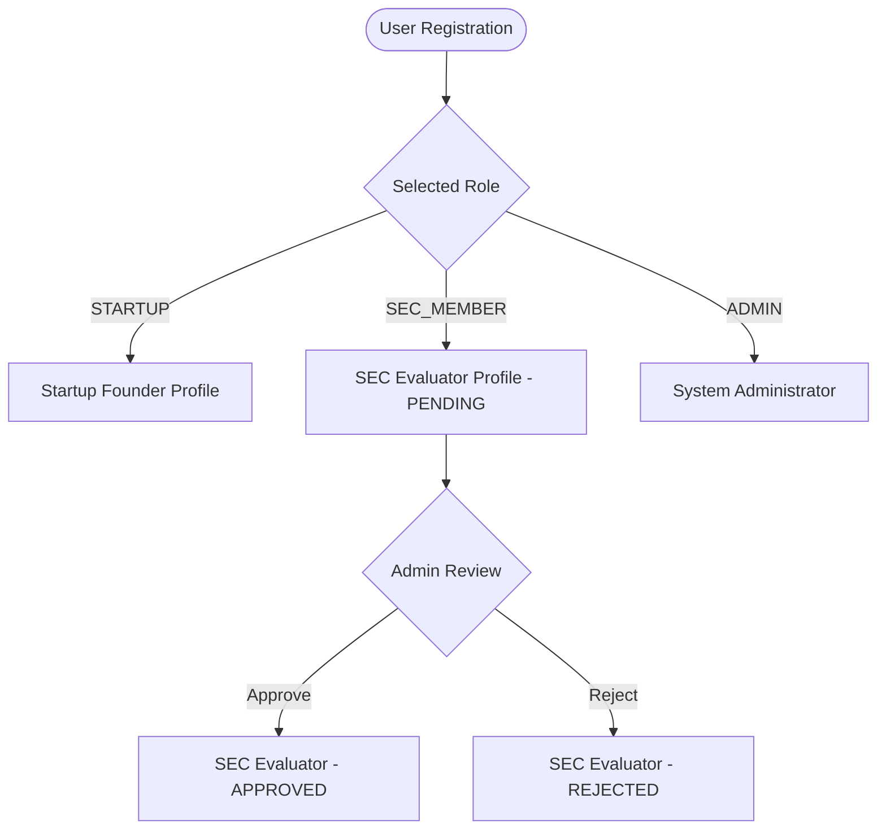
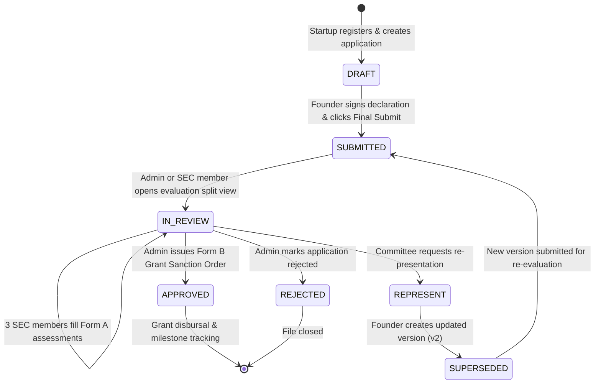
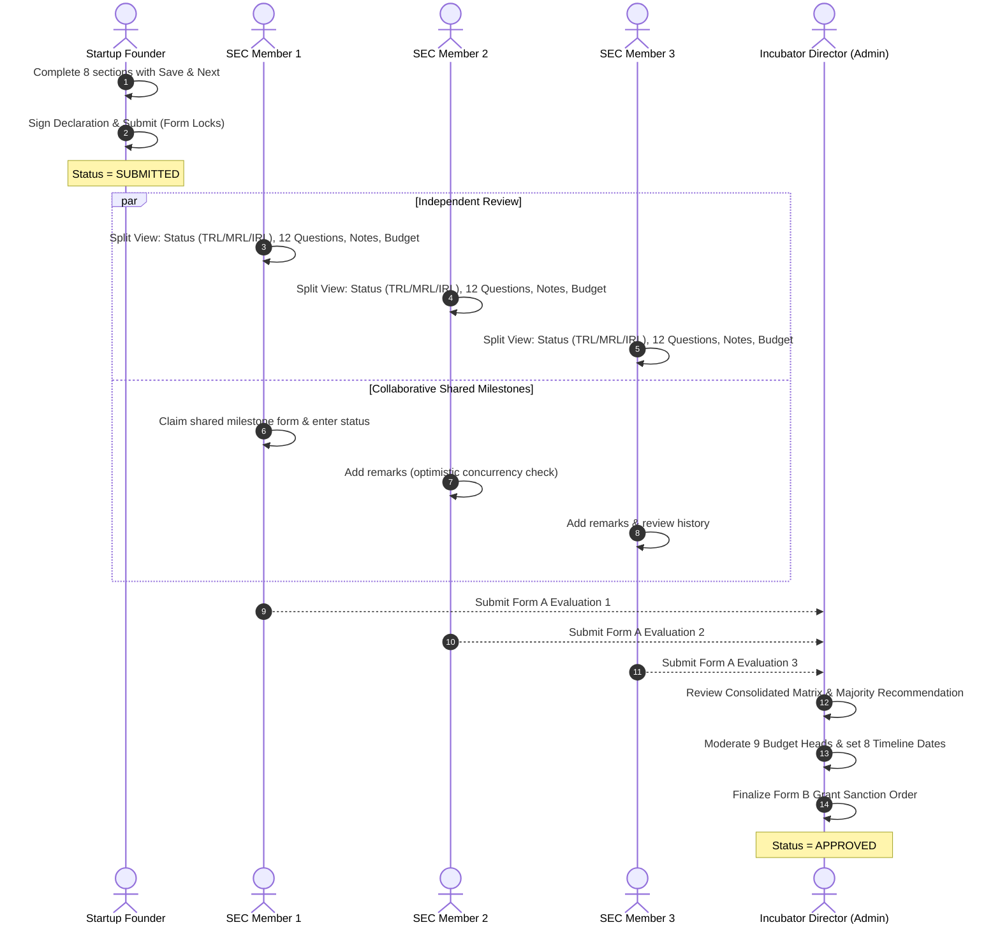

# Operational Logic & System Architecture Guide (LOGIC.md)

**Target Audience**: ERP Cell, ITM University IT Staff, Incubator Directors, and Administrative Staff.  
**System**: IDEAPAD Seed Fund Portal (Native PHP 8 + MySQL)

---

## 1. Executive Summary & Purpose

The **IDEAPAD Seed Fund Portal** automates the entire lifecycle of innovation and seed grant funding at ITM University. It facilitates student startup applications, coordinates the three-member **Startup Evaluation Committee (SEC)** review panel, provides synchronized split-screen evaluation, and enables official **Form B Grant Sanction Orders** signed off by university authorities.

The system is built entirely on native **PHP 8** and **MySQL (InnoDB)**, with zero external server dependencies, making it seamlessly compatible with standard cPanel / Apache environments and phpMyAdmin.

---

## 2. User Roles & Permission Matrix

The system enforces strict Role-Based Access Control (RBAC) across three distinct roles:

| Capability / Action | Startup Founder (`STARTUP`) | SEC Evaluator (`SEC_MEMBER`) | Administrator (`ADMIN`) |
| :--- | :---: | :---: | :---: |
| Self-Register Account | Yes (Instant Access) | Yes (Requires Approval) | System Seeded |
| Create & Edit Application Draft | Yes (Owned only) | No | No |
| Upload Identity & Proposal Documents | Yes | No | View / Verify |
| Client-Side Image Compression (100–150 KB) | Automatic on Upload | N/A | N/A |
| Submit Proposal (Lock Form) | Yes | No | No |
| Split-Screen Form A Evaluation | No | Yes (Once Approved) | View Consolidated |
| Edit Shared Milestone Form | No | Yes (Collaborative Concurrency) | View |
| Vote on Grant Tier & Suggest Budget | No | Yes (Independent per member) | View Comparison |
| Approve / Reject SEC Member Accounts | No | No | Yes |
| Finalize Form B Grant Sanction Order | No | No | Yes |
| Print Official Form A / Form B Dossiers | View Sanctioned | Printable Form A | Printable Form A & B |
| Inspect Immutable Audit Logs | No | No | Yes |

---

## 3. Application Lifecycle & State Machine

### State Definitions & Triggers
1. **`DRAFT`**:
   * *Trigger*: Automatically generated upon startup account registration.
   * *Permissions*: Founder can edit all 8 sections, save partial progress using **Save & Next**, upload documents, and modify budget items.
   * *Visibility*: Hidden from SEC members; visible to Admin as "In Preparation".
2. **`SUBMITTED`**:
   * *Trigger*: Founder signs the policy declaration, confirms budget items, and clicks **Final Submit**.
   * *Effect*: **Application is completely locked** (`isReadOnly = true`). No further changes can be made by the founder.
   * *Visibility*: Appears in SEC evaluation queues and Admin dashboard.
3. **`IN_REVIEW`**:
   * *Trigger*: Any SEC member or Admin begins evaluation or marks pre-checks completed.
   * *Effect*: Unlocks Form A split view for the 3 committee members.
4. **`APPROVED`**:
   * *Trigger*: Administrator finalizes the **Form B Grant Sanction Order**, moderates the budget across the 9 headers, and confirms the 8 implementation dates.
   * *Effect*: Triggers grant sanction notification and activates the 8-milestone post-approval tracker on the founder's `/status.php` page.
5. **`REPRESENT`**:
   * *Trigger*: Committee determines proposal needs substantial iteration before funding approval.
   * *Effect*: Allows founder to generate a linked revision (`supersedesId`), preserving audit history while updating experiment details.

---

## 4. SEC Evaluator Approval & Security Gate

To maintain compliance and confidentiality of applicant intellectual property:
1. When a professor or industry expert registers at `/sec-register.php`, their account is automatically created with:
   $$\text{role} = \text{SEC\_MEMBER}, \quad \text{approvalStatus} = \text{PENDING}$$
2. If an evaluator attempts to log in while `PENDING`, the authentication system intercepts the session and displays an informative holding notice:
   > *"Your SEC Evaluator account is pending Administrator review and approval. Access to applicant sheets is restricted until approved."*
3. The Administrator navigates to `/admin.php`, inspects the evaluator's name, designation, department, and email, and clicks **Approve**.
4. Once approved (`approvalStatus = APPROVED`), the evaluator gains access to the SEC evaluation dashboard at `/sec.php`.

---

## 5. Committee Assessment Mechanics (Form A)

Under Policy P8, **three SEC experts** independently evaluate the startup proposal. The system aggregates their reviews using the following mechanics:

### 1. Status Scales (TRL, MRL, IRL 1–9)
Each of the 3 members assigns an achieved level on three scales:
* **TRL 1–9**: Technology Readiness (Idea/principle to Market launch).
* **MRL 1–9**: Manufacturing Readiness (Basic concept to Mass production).
* **IRL 1–9**: Investment/Integration Readiness (Integration concept to Fully integrated).
* *Consolidation*: Form A displays a 3-column comparative matrix showing the consensus level across all members.

### 2. Collaborative Shared Milestones with Optimistic Concurrency
* **Policy Rule P8.2**: There is *one shared milestone form* between the three members.
* **Concurrency Control**: 
  - Every milestone update sends an `updatedAt` timestamp.
  - If Member 2 attempts to save after Member 1 modified an item, the system detects the newer timestamp and prevents accidental overwrites.
  - All changes are recorded in the `MilestoneEditLog` table, generating a signed correction audit trail displayed on the printable Form A.

### 3. The 12 Rubric Questions & Decision Guide
* **Rubric Breakdown**:
  * **Section A (Technical Soundness, Q1–7)**: Problem clarity, hypothesis, core technology test, methodology feasibility, tools identified, TRL-2 validation, TRL-3 proof.
  * **Section B (Market Worthiness, Q8–10)**: Customer need, risk reduction, post-TRL-3 use case.
  * **Section C (Execution Readiness, Q11–12)**: Realistic timeline, adequate technical competence.
* **Decision Guide Automation**:
  - Live advisory counter flags `Mostly YES` (Recommend Funding) vs `Multiple NO (≥3)` (Revision Required).

### 4. Independent Budget Moderation
Each member enters their recommended budget under the 9 Annexure 1 headers. The Admin console automatically computes the average suggested allocation across funding members.

---

## 6. Admin Form B Grant Sanction Order

Policy P9 dictates that the incubator administration issues the definitive sanction:
1. **Grant Decision**: Selects approved tier (`Validation Grant`, `Proof Grant`, `Scaling Grant`, `None/Rejected`). If the decision departs from the SEC majority, a required **Override Justification Note** must be entered.
2. **Sanctioned Budget Allocation**: Moderated amount under each of the 9 headers, validated against the tier ceiling.
3. **Approved Timeline (8 Dates)**:
   1. *Grant Approval Date*
   2. *Fund Release Date*
   3. *Experiment Duration* (e.g. 4–6 months)
   4. *Mid-Review Date*
   5. *Grant Utilization Deadline*
   6. *Experiment Completion Date*
   7. *Final Submission Date*
   8. *Closure Date*
4. **Approval Blocks**: Five official signatures:
   - Vice Chancellor, ITM University
   - Dean / HoD of applicant's School
   - Director, IDEAPAD
   - Assistant Director (Startups)
   - SEC Evaluator

---

## 7. Split-Screen Evaluation Interface Mechanics

The evaluator interface at `/sec.php?id=<id>` provides an ergonomic dual-pane split view:
* **Left Pane (Application Dossier)**: Displays the startup's submitted application, 10 experiment fields, budget table, justifications, and uploaded documents.
* **Right Pane (Form A Assessment)**: Contains the evaluator's interactive scoring tabs:
  1. *SOP Pre-checks*
  2. *Status Levels (TRL/MRL/IRL)*
  3. *Shared Milestones*
  4. *12 Rubric Questions*
  5. *Grant Evaluation & Budget Moderation*
* **Synchronized Auto-Scrolling**: When the evaluator navigates between tabs on the right, JavaScript automatically scrolls the left dossier pane to the corresponding section (e.g., clicking *Budget* scrolls the left pane to the *Itemized Requirement Table*).
* **Desktop Resizer**: Draggable middle divider allows adjusting the relative pane width (saved in browser `localStorage`).
* **Mobile Toggle**: On mobile devices, a responsive toggle seamlessly switches between "Startup Proposal" and "My Assessment".

---

## 8. Save & Next Multi-Section Form Architecture

All multi-section forms (Startup Application, SEC Form A, and Admin Form B) incorporate standardized navigation:
* **Bottom Controls**:
  - **Back Button**: Navigates to previous section (hidden on Section 1).
  - **Save & Next Button**: Executes an asynchronous partial save via AJAX/POST, displays a transient "Saved successfully" toast, disables button during network transit, advances to the next section, and scrolls to the top.
  - **Last Section**: Displays **Save Draft** and **Final Submit**.
* **Section Completion Indicators**: Real-time counter badges (e.g. `10/10 Experiments`, `12/12 Questions`) update dynamically as fields are completed.
* **Pre-Submission Validation**: Clicking Final Submit validates all sections across the form. If any section is incomplete, submission is blocked and clickable jump links are displayed directly to the missing fields.
